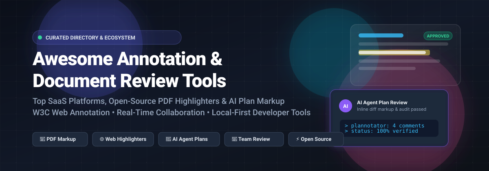

# 📑 Awesome Annotation & Document Review Tools 🚀

  

  
  
  
  
  
  

---

## 📌 Executive Overview & SEO Guide

Welcome to the definitive **Awesome Annotation & Document Review Tools** repository — a curated catalog comparing leading **SaaS/hosted platforms** and high-velocity **open-source GitHub projects**. 

Whether you need **in-browser PDF markup**, **collaborative document review workflows**, **W3C Web Annotation protocol** implementations, **digital signature workflows**, or **local AI coding agent plan markup** (e.g., Claude Code, Codex, Gemini CLI, Copilot CLI, OpenCode), this directory provides transparent pricing, free-tier limits, market valuations, and star rankings to help engineers, researchers, educators, legal teams, and product managers find the optimal tooling.

### 🧭 Key Navigation

- [📊 Sector Overview & Market Dynamics](#-sector-overview--market-dynamics)
- [☁️ SaaS & Hosted Platforms](#️-saas--hosted-platforms)
- [💻 Open-Source GitHub Projects](#-open-source-github-projects)
- [🛠️ Architectural Patterns & Frameworks](#️-architectural-patterns--frameworks)
- [🤝 How to Contribute](#-how-to-contribute)
- [💖 Support & Sponsorship](#-support--sponsorship)
- [⭐ Star History](#-star-history)
- [⚖️ Disclaimer & Data Privacy](#️-disclaimer--data-privacy)

---

## 📊 Sector Overview & Market Dynamics

The global document and data annotation tools market is valued at approximately **$1.7B – $2.5B (growing toward $3.1B+ with a 21%–32% CAGR)**, driven by enterprise digitisation, collaborative remote review, and the rapid expansion of LLM training and multimodal AI workflows. 

The sector is **moderately fragmented**: while massive incumbents and document giants (such as airSlate/pdfFiller and Ceros) anchor large-scale enterprise suites, the rapid rise of local-first developer needs, academic research protocols (W3C Web Annotation), and specialized AI plan review tools ensures a robust, expanding ecosystem of independent point solutions and high-star open-source alternatives rather than a winner-take-all outcome.

---

## ☁️ SaaS & Hosted Platforms

The following SaaS and cloud-hosted platforms provide web, PDF, image, and document review solutions. Platforms are ranked in **descending order by company scale** (estimated valuation / annual recurring revenue).

| 🏢 Platform | 📝 Focus & Key Capabilities | 💰 Starting Tier Price | 🎁 Free Tier / Trial Limits | 📈 Scale (Valuation / Revenue) |
| :--- | :--- | :--- | :--- | :--- |
| **[pdfFiller](https://pdffiller.com)** | Cloud-based PDF editor, document markup, e-signatures, and fillable form collaboration. | **$8.00 / user / month** (billed annually) or $20/mo month-to-month | **30-day free trial** with full editing and e-sign access; no permanent free plan | **$1.25B Valuation** (~$200M total parent ARR; ~$106M pdfFiller ARR, airSlate) |
| **[MarkUp.io](https://markup.io)** | Visual feedback & live review platform for placing contextual pins on websites, PDFs, images, and videos. | **$79.00 / month** (Pro plan billed annually) | **14-day free trial** of Pro plan; permanent free tier discontinued | **$500M Valuation** (~$24M ARR parent Ceros; ~$8M MarkUp.io line) |
| **[Kami & Kami Cloud](https://kamiapp.com)** | Collaborative PDF & digital classroom annotation platform with LMS integrations and audio/video comments. | **$149.00 / year** (Teacher Plan; ~$12.42/mo) | **Free Forever Basic Plan** (core view & draw/highlighter tools, 1000+ templates, no LMS integrations or multimedia comments; 30-day trial of Teacher tier upon signup) | **~$21.7M ARR** (Bootstrapped/venture-backed; 40M+ global users) |
| **[Hypothesis (Hosted)](https://hypothes.is)** | Hosted collaborative web & PDF annotation layer built on open W3C standards with university LMS integrations. | **Custom Institutional Pricing** (Free for individuals; campus licenses quote-based) | **Free Forever for Individuals** (unlimited public & private group web/PDF annotations; university LMS gradebook integration requires institutional license) | **$14M+ Funding** (Annotation Unlimited PBC; spin-out of 501(c)(3) Hypothesis Project) |
| **[Lumin PDF](https://luminpdf.com)** | Real-time cloud PDF viewer, markup suite, and team document collaboration with Google Drive & Dropbox sync. | **$9.00 / month** (billed annually) or $15/mo month-to-month | **Free Forever Plan** (capped at 3 document annotations/month, 5 free signature requests/month; advanced OCR and text edit locked) | **~$4.6M ARR** (Bootstrapped private company; 100M+ registered users) |
| **[Scrible](https://scrible.com)** | Cloud research, web annotation, citation management, and student bibliography collaboration platform. | **$35.00 / year** (Student Edu Pro) or **$119.99 / year** (Teacher Edu Pro) | **Free Edu Plan** (500 MB cloud storage limit, 1 library, 4 highlight colors max, basic MLA/APA citation, no outline editor or analytics; 14-day trial of Edu Pro) | **~$3.0M ARR** (Private EdTech venture; NSF-funded roots) |
| **[Weavy](https://weavy.com)** | Embeddable developer collaboration SDK for adding in-app document markup, chat feeds, and contextual review. | **$199.00 / month** (Developer Pro Cloud Plan; $0.15/additional MAU) | **Free Forever Developer Tier** (Free up to 50 Monthly Active Users (MAU), self-hosted dev environment, community support) | **~$2.5M ARR** (Private growth-stage dev-tools provider) |
| **[Diigo](https://diigo.com)** | Web highlighter, social bookmarking engine, sticky notes, and personal research archive library. | **$7.00 / year** (Social Tier) or **$40.00 / year** (Professional Tier) | **Free Forever Plan** (capped at 500 cloud bookmarks, 100 highlights per month, 1 outline list, ad-supported interface) | **~$1.5M ARR** (Bootstrapped profitable web-utility pioneer) |
| **[Annotate.com](https://annotate.com)** | Structured collaborative document annotation workspace; transitioned to modern Markdown, GitHub sync & AI reading. | **$12.00 / user / month** (Professional Plan) | **Free Forever Plan** (includes comments, highlights, GitHub sync up to 2 repos, 30 MB storage, and 50 files limit) | **Privately Held** (Legacy enterprise web-collaboration service retired in Nov 2023; modernized for dev workflows) |

---

## 💻 Open-Source GitHub Projects

Explore the leading self-hosted, privacy-first, and protocol-compliant open-source repositories for document review, PDF editing, and AI plan markup. 

The list below is **sorted in descending order by GitHub_Stars ⭐**. Each Stars_Badge links directly to that repository's official stargazers page.

| 📦 Repository & Link | ⭐ GitHub_Stars | 🔍 Category | 📄 Description & Architecture |
| :--- | :---: | :--- | :--- |
| **[Stirling-Tools/Stirling-PDF](https://github.com/Stirling-Tools/Stirling-PDF)** |  | Self-Hosted PDF Suite | Powerful, locally hosted Docker web application for editing, annotating, splitting, merging, redacting, and signing PDFs without cloud leaks. |
| **[mozilla/pdf.js](https://github.com/mozilla/pdf.js)** |  | PDF Engine & Viewer | Mozilla's foundational HTML5/JavaScript PDF viewer and rendering library with native freehand drawing, text highlighting, and annotation layers. |
| **[paperless-ngx/paperless-ngx](https://github.com/paperless-ngx/paperless-ngx)** |  | Document Management & OCR | Community-supported open-source document archive system featuring automated OCR indexing, full-text tagging, metadata review, and workflow tracking. |
| **[logseq/logseq](https://github.com/logseq/logseq)** |  | Knowledge Base & PDF Reader | Privacy-first, local-first outliner and Markdown notebook with built-in PDF highlighting, bidirectional backlinks, and block-level annotation references. |
| **[HumanSignal/label-studio](https://github.com/HumanSignal/label-studio)** |  | Multi-Modal Data Labeling | Multi-format data annotation and document review platform supporting OCR bounding boxes, text spans, HTML markup, and RLHF validation. |
| **[zotero/zotero](https://github.com/zotero/zotero)** |  | Academic Research Assistant | Gold-standard research assistant with built-in PDF/EPUB reader, color-coded highlighting, sticky notes, citation generation, and note extraction. |
| **[Documenso/Documenso](https://github.com/Documenso/Documenso)** |  | Open-Source E-Signature | Modern, open-source DocuSign alternative for collaborative document review, approval chains, field placement, and cryptographic document signing. |
| **[xournalpp/xournalpp](https://github.com/xournalpp/xournalpp)** |  | Stylus & PDF Annotation | Cross-platform C++ handwriting and note-taking application designed for stylus/tablet review, LaTeX math annotation, and audio-synced grading. |
| **[backnotprop/plannotator](https://github.com/backnotprop/plannotator)** |  | AI Agent Plan Review | Fast browser workspace for AI coding agents (Claude Code, Gemini CLI, Copilot) to highlight, review, and comment on agent plans, Markdown, and diffs. |
| **[pymupdf/PyMuPDF](https://github.com/pymupdf/PyMuPDF)** |  | Python PDF & Markup Engine | High-performance Python library (MuPDF bindings) for extracting annotations, programmatically creating highlights, redacting text, and rendering pages. |
| **[doccano/doccano](https://github.com/doccano/doccano)** |  | Text Annotation & Review | Open-source text annotation tool for human-in-the-loop machine learning, named entity recognition (NER), text summarization, and sentiment review. |
| **[ahrm/sioyek](https://github.com/ahrm/sioyek)** |  | Academic PDF Viewer | Keyboard-driven PDF viewer built for research papers with two-click reference portals, jumping to figures, smart jump markers, and fast navigation. |
| **[pdfme/pdfme](https://github.com/pdfme/pdfme)** |  | TypeScript PDF Generator & UI | Open-source TypeScript PDF generator and visual document designer with interactive web UI for adding text, signatures, barcodes, and review fields. |
| **[WorldBrain/Memex](https://github.com/WorldBrain/Memex)** |  | Web Highlighter & Knowledge Base | Local-first browser extension for highlighting articles, organizing research collections, full-text web search, and peer-to-peer web annotation. |
| **[hypothesis/h](https://github.com/hypothesis/h)** |  | W3C Annotation Backend | Flagship Python/PostgreSQL backend service implementing the W3C Web Annotation data model for collaborative highlighting and federated notes. |
| **[recogito/annotorious](https://github.com/recogito/annotorious)** |  | Image & Document Annotation UI | Modern JavaScript/TypeScript library for image and document annotation adhering to W3C Web Annotation standards with customizable React/Svelte UIs. |
| **[hypothesis/client](https://github.com/hypothesis/client)** |  | Web & PDF Annotation Client | Browser frontend and embeddable JavaScript client used by Hypothesis for anchoring inline text selections and managing threaded comment sidebars. |
| **[rudi-q/leed_pdf_viewer](https://github.com/rudi-q/leed_pdf_viewer)** |  | Privacy-First PDF Canvas | Modern desktop PDF viewer built with SvelteKit, Tauri, and PDF.js featuring pen markup, freehand sketching, sticky notes, and zero-telemetry viewing. |
| **[recogito/recogito-js](https://github.com/recogito/recogito-js)** |  | Semantic Text Markup | Lightweight JavaScript library for text annotation, semantic entity tagging, and relationship drawing on web documents. |
| **[plannotator/plannotator-tui](https://github.com/plannotator/plannotator-tui)** |  | Terminal Markdown Annotator | Rust-based terminal companion for reviewing and annotating Markdown docs, agent prompt diffs, and project specs directly from the CLI. |
| **[apache/incubator-annotator](https://github.com/apache/incubator-annotator)** |  | W3C Anchoring Primitives | Modular Apache library providing robust text anchoring, range selection algorithms, and fuzzy quote matchers conforming to W3C standards. |

---

## 🛠️ Architectural Patterns & Frameworks

Looking to architect a custom document review or annotation system? Here are proven open-source technology combinations:

1. **Self-Hosted Academic & Legal Review:**  
   Combine **[hypothesis/h](https://github.com/hypothesis/h)** (backend) + **[hypothesis/client](https://github.com/hypothesis/client)** (frontend) + **[mozilla/pdf.js](https://github.com/mozilla/pdf.js)** to run a completely private, W3C-compliant document annotation server behind your firewall.
2. **AI Coding Agent Plan Review & Gatekeeping:**  
   Pair **[backnotprop/plannotator](https://github.com/backnotprop/plannotator)** with your local CLI agents (Claude Code, Gemini CLI, OpenCode) to visually approve architecture specs, diffs, and execution steps before executing code changes.
3. **Enterprise Document Signing & Approvals:**  
   Deploy **[Documenso/Documenso](https://github.com/Documenso/Documenso)** with **[Stirling-Tools/Stirling-PDF](https://github.com/Stirling-Tools/Stirling-PDF)** for an all-in-one on-premise PDF generation, redacting, review, and legally valid e-signing suite.
4. **Knowledge Base PDF Integration:**  
   Embed **[logseq/logseq](https://github.com/logseq/logseq)** or **[zotero/zotero](https://github.com/zotero/zotero)** into your team's workflow to ensure highlighting directly generates bidirectional backlinks and persistent research notes.

---

## 🤝 How to Contribute

Contributions are welcome! Help us keep this directory up-to-date with new SaaS tools and open-source breakthroughs.

1. 🍴 **Fork** this repository.
2. 🌿 **Create a branch** for your feature or tool addition: `git checkout -b add-tool-name`.
3. ✏️ **Edit `README.md`**:
   - For SaaS tools: include starting tier price, free tier/trial limits, and company scale (ARR / valuation).
   - For Open-Source tools: include GitHub_Stars_Badge (`style=social&color=white` linking to `/stargazers`), category, and architecture summary.
4. 🚀 **Submit a Pull Request** with a concise description of why the tool is a valuable addition.

---

## 💖 Support & Sponsorship

Thank you so much for exploring and using **Awesome Annotation & Document Review Tools**! 🎉

If you find this repository valuable or if it helps in your projects, research, or daily workflows, please consider supporting the project:

- ⭐ **Star this repository** to help others discover it on GitHub.
- 🍴 **Fork and share** it with your fellow developers, researchers, and teams.
- 📢 **Spread the word** across your community, Twitter/X, LinkedIn, or Discord.
- ☕ **Buy a coffee & sponsor**: Support ongoing research, updates, and maintenance by sponsoring via the [GitHub Sponsors Dashboard](https://github.com/sponsors/ishandutta2007).

Your support keeps this ecosystem thriving, transparent, and up-to-date! 🙌

---

##  Star History

---

## ⚖️ Disclaimer & Data Privacy

- 🔍 **Community Maintained:** This repository is a community-curated educational and technical resource; inclusion does not constitute an endorsement.
- 🔒 **Document Privacy:** When reviewing confidential legal, medical, financial, or proprietary intellectual property, ensure cloud providers meet your organization's compliance standards (HIPAA, GDPR, SOC2).
- 🛡️ **Self-Hosted Security:** Ensure self-hosted annotation servers (such as Stirling-PDF, Paperless-ngx, or Hypothesis) enforce robust HTTPS/TLS encryption, JWT authentication, and strict CORS policies.

---

  <b>Built with ❤️ for researchers, engineers, educators, legal analysts, and open-source contributors worldwide.</b> 
  <i>Star ⭐ this repository to stay updated with the document review &amp; annotation landscape!</i>

